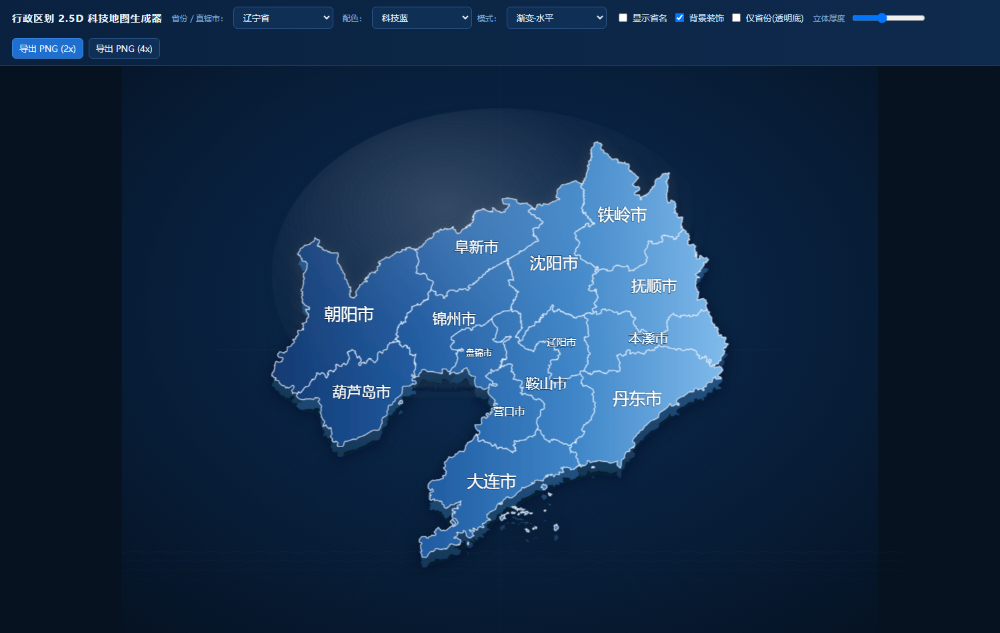
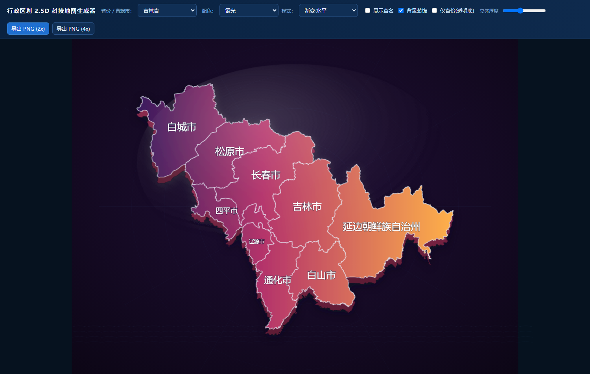
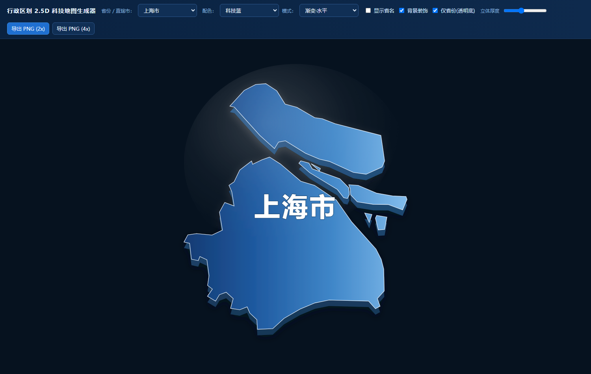
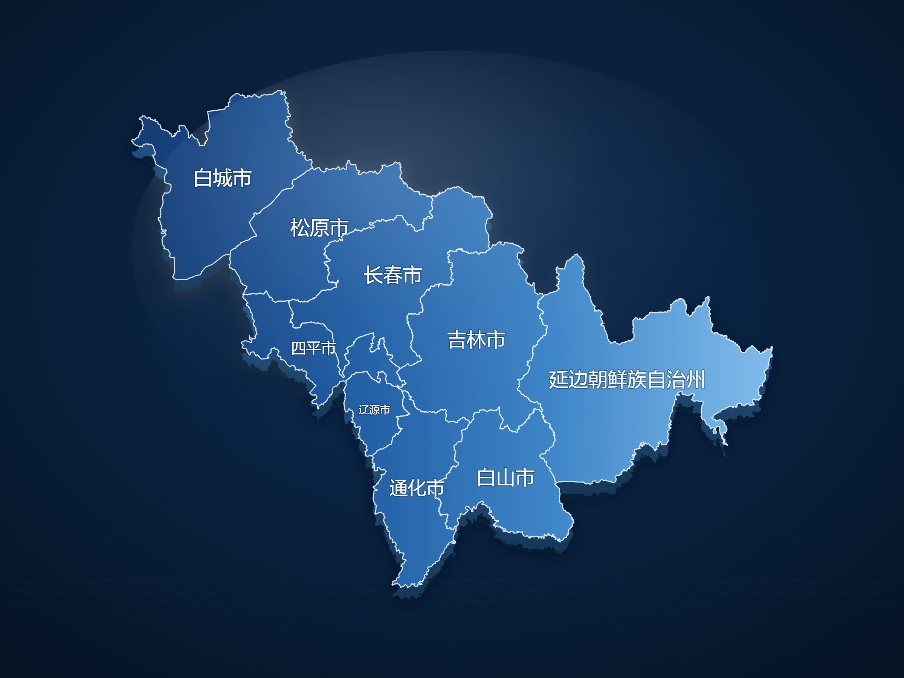

# 行政区划 2.5D 科技地图生成器

一个纯前端、可离线运行的行政区划地图生成器：基于真实行政边界数据，把全国省级行政区渲染成「2.5D 蓝色科技立体」风格的地图，支持切换 35 个省级行政区、8 套配色、4 种渐变模式，并可一键导出高清 PNG（含透明底模式）。

## ✨ 功能特性

- **全国 35 个省级行政区**（含港澳台），基于阿里 DataV 真实行政边界
- **2.5D 立体效果**：省域带厚度侧面、表面渐变、受光高光，背景含同心圆 / 放射线 / 水波纹装饰
- **白线分区 + 白字标注**：地级市 / 市辖区清晰分隔，标签带碰撞避让与描边光晕，密集区域也不重叠
- **8 套配色**：科技蓝 / 靛紫 / 翠绿 / 赤金 / 青橙 / 玫红 / 石墨灰 / 霞光
- **4 种模式**：渐变·水平 / 渐变·对角 / 渐变·径向 / 纯色
- **「仅省份」模式**：透明背景、不显示市 / 区划分界线、只显示省名（适合做素材）
- **一键导出**：2x / 4x PNG，透明底模式导出真实透明背景

## 🖥 运行界面预览

打开 `index.html` 即可看到如下界面（顶部工具栏可切换省份、配色、模式、立体厚度并导出图片）：

**默认界面 · 辽宁省（科技蓝 + 水平渐变）**



**切换配色 · 吉林省（霞光：紫 → 品红 → 橙金）**



**「仅省份(透明底)」模式 · 上海市（无市区线，只显示省名）**



## 🎨 生成效果展示

| 常规 2.5D 立体地图（吉林省） | 仅省份透明底（上海市） |
| --- | --- |
|  |  |

> 更多配色与省份成品图可在本地运行 `node render.js` 生成（见下方「批量导出图片」）。

## 🚀 快速开始（零依赖）

直接用浏览器打开 `index.html` 即可使用：

1. 选择 **省份 / 直辖市**
2. 选择 **配色** 与 **模式**
3. 勾选 **仅省份(透明底)** 可切换为透明背景、只显示省名
4. 点击 **导出 PNG (2x) / (4x)** 下载图片

> 若浏览器对本地 `file://` 打开有限制，可在本目录执行 `python -m http.server` 后访问 `http://localhost:8000/`。

## 📁 目录结构

| 文件 | 说明 |
| --- | --- |
| `index.html` | 页面与交互界面 |
| `app.js` | 渲染逻辑（投影、2.5D、配色、标注、导出） |
| `geo-data.js` | 预生成的行政边界数据（`window.GEO` / `window.GEO_OUTLINE`），离线运行的核心 |
| `data/` | 原始行政边界 GeoJSON（用于重新生成 `geo-data.js`） |
| `process.py` | 数据处理脚本：精简坐标、生成 `geo-data.js` |
| `render.js` | 批量渲染脚本（Node + Playwright） |
| `screenshot_ui.js` | 运行界面截图脚本（Node + Playwright） |
| `verify.js` | 透明底像素校验脚本 |
| `screenshots/` | README 中展示的界面截图与效果图 |
| `package.json` | Node 依赖声明 |

## 🛠 进阶：重新生成边界数据

如需更新或重新生成 `geo-data.js`：

```bash
pip install requests        # 首次需要，用于下载数据
python process.py
```

> 数据来自阿里 DataV，脚本内置下载逻辑；无网络时可直接使用已有的 `geo-data.js`。

## 🖼 批量导出图片

1. 安装依赖：`npm install`
2. 安装浏览器：`npx playwright install chromium`
3. 运行：`node render.js`

输出位于 `output/`（常规版 + 仅省份透明版），`preview/` 为各配色展示图。

## 📌 说明

- 行政边界数据来源：阿里云 DataV.GeoAtlas（<https://datav.aliyun.com/portal/school/atlas/area_selector>），请遵循其使用条款。
- 本项目仅用于地图可视化展示，行政界线仅供参考，正式用途请以国家官方测绘数据为准。
- 台湾省数据由全国总数据中提取，以保持生成器完整。
